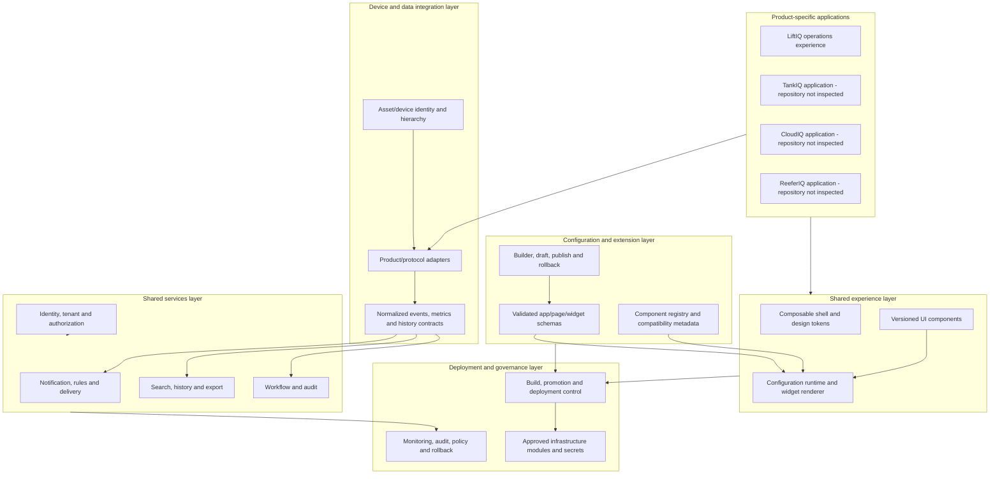

# Recommended AEP Architecture

This is a conceptual proposal based on the inspected prototypes. It separates **verified current implementations** from **recommended future layers**. It does not assume all products share navigation, device schemas, event semantics, or operational workflows.

## Conceptual architecture

## Layer responsibilities and evidence

| Layer | Responsibility | Existing contribution found | Missing / boundary recommendation | Dependencies |
|---|---|---|---|---|
| **Product-specific application layer** | Own product navigation, workflows, product terminology, domain calculations and specialized views. | **Verified:** LiftIQ has station, alarm, telemetry, watch and operations pages. AssetIQ Notifications is a separate cross-product notification prototype. | TankIQ, CloudIQ, and ReeferIQ implementations are unavailable here. Keep alarm lifecycle, pump controls, refrigeration rules, tank metrics, etc. in product-owned domain modules unless evidence supports a common domain model. | Identity/asset services and shared contracts should be consumed through adapters; product apps retain independent deployability and experience composition. |
| **Shared UI/component layer** | Supply tested, accessible and versioned visual primitives and optional higher-level widgets. | **Verified:** both apps have local heading, badge, empty-state, modal/drawer or metric helpers. | **Recommended:** token package, neutral component contracts, data/state adapters, loading/error/empty/accessibility guidance. Do not share product-specific calculations. | Stable UX requirements, package ownership, cross-app validation, version policy. |
| **Application configuration/runtime layer** | Render validated app/page/widget configuration where customers or admins need adaptation. | **Verified:** no runtime renderer found. Existing React components are authored in code. | **Recommended:** begin with bounded dashboards/widgets and declarative bindings; avoid arbitrary JSX/code. Add schema validation, permissions-aware component availability and version migration. | UI component contracts, normalized data/query model, identity/authorization, component registry. |
| **Device/data integration layer** | Adapt protocol-specific data to canonical asset, metric, event and history contracts while preserving source evidence. | **Verified:** LiftIQ has typed mocks and a proposed alarm event mapper; notification app has matching contract and mock adapter. | **Recommended:** authoritative device registry, protocol adapters, metric units/quality/time semantics, event transport, tenant resolution and idempotency. Keep raw payload permission and retention explicit. | Product/device schemas, asset identity, tenant authorization, event ownership, observability. |
| **Shared services layer** | Provide cross-product identity, notification, query/history/export, audit and workflow capabilities. | **Verified:** only local UI simulations and in-memory logic exist in accessible apps. | **Recommended:** integrate existing company services if present; otherwise define service boundaries and server-side APIs. Notification acknowledgement, source alarm state, and delivery must remain separate models. | Identity, event/metric contracts, data stores, delivery-provider decisions, audit and SLO policies. |
| **Identity, permissions and tenant isolation** | Authenticate people/services, resolve tenant scope and authorize every read/write at trusted server boundaries. | **Verified:** only demo controls and client-side filtering. | **Recommended:** integrate organization identity provider; resolve tenant/asset permission server-side; include service identities, policy tests, access revocation and audit. UI filtering is for UX only. | Confirm existing identity, tenant hierarchy, asset ownership and service-to-service auth. This is a foundation for data, builder and deployment. |
| **Extension and component registry** | Publish approved components/extensions with manifest, version, dependencies, permissions and compatibility rules. | **Verified:** no registry found. | **Recommended:** start with trusted, signed first-party components. Treat extensions as packages/isolated bundles with allow-listed capabilities; do not execute generated code in a privileged app context. | Common contracts, build isolation, review policy, version pinning, runtime sandbox and rollback. |
| **Deployment and infrastructure** | Build, test, promote, provision isolated environments, manage secrets and roll back releases/configuration. | **Verified:** independent Vite build/preview scripts and checked-in distribution outputs. | **Recommended:** first inspect central CI/CD and cloud modules. Add approved environments, immutable artifact promotion, secrets manager integration, tenant isolation model, health checks and rollback. | Platform DevOps/cloud repositories, security policy, observability, identity and release ownership. |
| **Monitoring and governance** | Track service health, data quality, access/admin operations, configuration changes, extension events and lifecycle. | **Verified:** local alarm/activity history and an in-memory notification audit UI. | **Recommended:** durable correlated audit and operational telemetry, retention/access rules, alerting, policy enforcement and release evidence. | Shared service boundaries, event IDs/correlation, identity, data-retention policy and infrastructure platform. |

## Reuse boundaries

- **Good candidates for shared form:** page headings, buttons, cards, badges with neutral severity/status input, tables, filters, date formatting, empty/loading/error patterns, charts that accept metric metadata and series as input.
- **Keep product-owned:** alarm activation/clear/recovery rules, pump and station state interpretation, totalizer semantics, refrigeration/tank thresholds, device commands, maintenance policy, and product-specific navigation/workflows.
- **Share contracts before visuals where necessary:** asset identifiers, tenant context, normalized event envelopes, metric names/units/quality/timezone, paging/filter semantics, and audit actor/correlation fields. Preserve original source references alongside normalized values.
- **Do not treat notification thread as source event:** the current two-app adapter already shows the distinction between alarm lifecycle, normalized event, notification thread, and delivery attempt. A production model should keep these separately addressable and correlated.

## Architectural assumptions requiring verification

- Whether a central identity, device registry, event broker, notification provider, telemetry store, audit platform, CI/CD system or AWS module library exists outside this checkout.
- Whether customer-authored configuration will be limited to dashboards or eventually include routing, data bindings, workflows and whole-page composition.
- Whether extensions are code packages, sandboxed web components, declarative widgets, or a combination. The safest initial boundary is declarative configuration over vetted first-party components.
